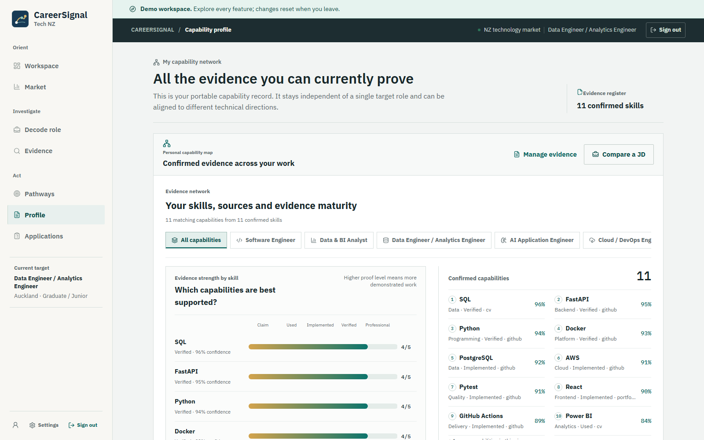
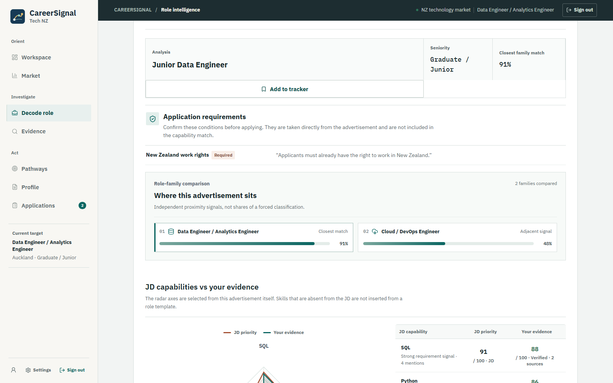
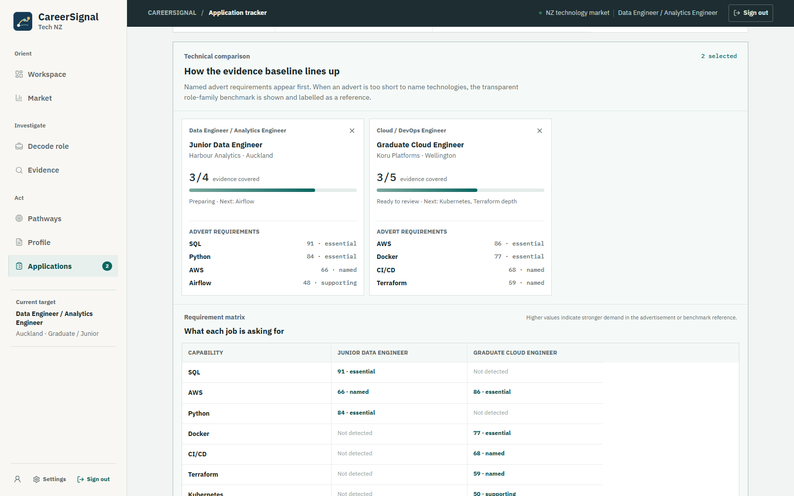
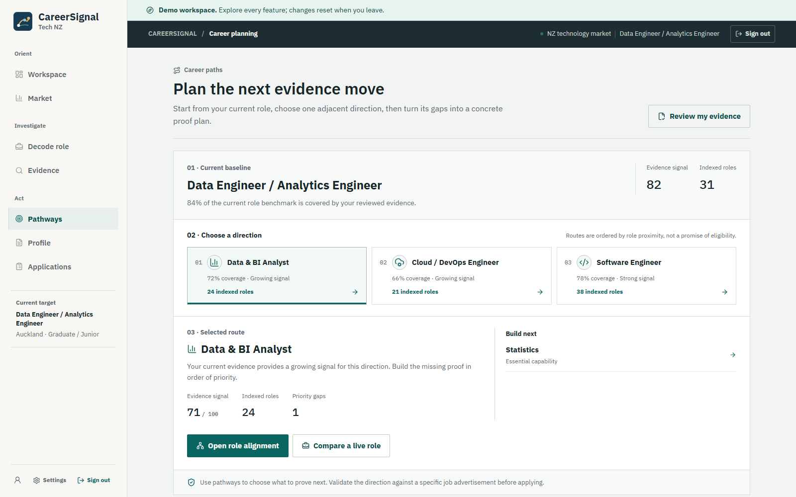

# CareerSignal Tech NZ

[](https://github.com/liyang6620/career-signal-tech-nz/actions/workflows/ci.yml)
[](https://github.com/liyang6620/career-signal-tech-nz/actions/workflows/codeql.yml)
[](https://github.com/liyang6620/career-signal-tech-nz/actions/workflows/live-smoke.yml)
[](https://github.com/liyang6620/career-signal-tech-nz/actions/workflows/android-apk.yml)
[](LICENSE)

CareerSignal turns CV, GitHub and New Zealand job-advertisement evidence into an inspectable capability profile. It separates what a candidate can demonstrate from what a role asks for, then supports role comparison, career planning and application tracking without hiding the reasoning behind a single opaque score.

This repository targets a stable interview demo and a product-grade portfolio standard. It does not claim the operational guarantees required for unrestricted commercial use.

## Try the demo

- Web: [career-signal-tech-nz.pages.dev](https://career-signal-tech-nz.pages.dev)
- API health: [health](https://careersignal-api-ze3r.onrender.com/health) · [readiness](https://careersignal-api-ze3r.onrender.com/ready)
- Android: download `CareerSignal-debug-apk` from the latest [Android workflow](https://github.com/liyang6620/career-signal-tech-nz/actions/workflows/android-apk.yml)

Select **Explore live demo** on the home page. It opens a safe, pre-populated workspace without registration or email verification. Demo changes remain in the browser session and never write to a real account.

The API uses Render's free tier and may need roughly 10–60 seconds to wake after inactivity. The client shows this state and retries transient gateway responses instead of presenting an indefinite loading screen.

### 90-second interview walkthrough

1. Open **Profile** to show reviewed evidence, maturity, confidence and source coverage.
2. Switch role-family filters to explain how one evidence record travels across five technical directions.
3. Open **Decode role** and show advert-specific requirements and explainable evidence comparison.
4. Open **Applications**, select two saved roles and compare technical requirements and decision factors.
5. Open **Pathways** to turn the highest-priority evidence gap into a next project decision.

## Product tour

| Evidence-led capability profile | Job-advertisement decoder |
| --- | --- |
| [](docs/screenshots/capability-profile.png) | [](docs/screenshots/role-decoder.png) |
| **Saved-role comparison** | **Career pathway planner** |
| [](docs/screenshots/saved-role-comparison.png) | [](docs/screenshots/career-pathways.png) |

## Product capabilities

- Private CV ingestion with file checks, extraction status and user-reviewed evidence
- Conservative public GitHub evidence extraction with provenance
- Portable capability profile across Software, Data, AI and Cloud role families
- New Zealand market explorer backed by governed, source-linked records
- Job-description decoder with hard eligibility requirements kept separate from skill fit
- Cited employer-evidence retrieval and optional grounded summaries
- Saved-role comparison, notes, status history and application tracking
- Account export and deletion controls
- Installable PWA and Capacitor Android wrapper

Scores are deterministic and auditable. Evidence maturity, extraction confidence, source triangulation, role demand and market frequency remain separate signals. They indicate the strength of available evidence, not human ability or a hiring outcome.

## Architecture

```text
React / TypeScript / Vite / Capacitor
                |
        FastAPI application
          |             |
PostgreSQL + pgvector   S3-compatible private storage
          |
governed collectors + hybrid retrieval + background worker
```

Core stack:

- React 19, TypeScript, Vite, ECharts and React Flow
- Python 3.12, FastAPI, Pydantic and SQLAlchemy
- PostgreSQL 16, pgvector and Alembic
- Argon2 passwords, short-lived JWTs and rotated refresh sessions
- S3-compatible storage, file-signature checks and ClamAV-compatible scanning
- GitHub Actions for CI, CodeQL, Android builds and deployed smoke checks

See [architecture](docs/architecture.md), [product scope](docs/product-scope.md) and [scoring methodology](docs/skill-benchmark-methodology.md) for design details.

## Run locally

Prerequisites: Node.js 22, Python 3.12 and Docker for the full PostgreSQL/storage stack.

```bash
git clone https://github.com/liyang6620/career-signal-tech-nz.git
cd career-signal-tech-nz
cp .env.example .env
docker compose up --build
```

For separate development servers:

```bash
cd backend
python -m venv .venv
# Windows: .venv\Scripts\activate
pip install -e ".[dev]"
alembic upgrade head
uvicorn app.main:app --reload --port 8001
```

```bash
cd frontend
npm ci
npm run dev
```

The frontend defaults to `http://localhost:5173`; the API and OpenAPI UI use `http://localhost:8001` and `http://localhost:8001/docs`.

## Verification

```bash
cd backend
ruff check app tests
python -m app.evaluation_report --minimum 1.0
pytest --cov=app --cov-report=term-missing --cov-fail-under=80

cd ../frontend
npm run lint
npm run test:unit
npm run build
npm run test:e2e
```

CI also starts `pgvector/pgvector:pg16`, applies every Alembic migration and enables the PostgreSQL hybrid-search integration test. Playwright runs critical journeys in Desktop Chrome and a Pixel 7 viewport, including accessibility checks. Frontend unit coverage has enforced thresholds; backend coverage must remain at or above 80%.

The labelled evaluation command emits machine-readable JD role/scope accuracy, expected-skill recall, eligibility recall, CV skill recall and evidence-level constraint accuracy. Retrieval evaluation reports Recall@K and mean reciprocal rank when a governed corpus has been indexed. Dataset size and interpretation are documented in [evaluation](docs/evaluation.md).

## Security and data boundaries

- `.env` and credentials are excluded from Git.
- Market writes require a separate ingestion credential.
- CV evidence must pass validation and explicit user review before scoring.
- API routes, mutations and cross-origin data are excluded from service-worker caching.
- CodeQL and dependency updates run in GitHub Actions.
- Vulnerability reports follow [SECURITY.md](SECURITY.md); contributions follow [CONTRIBUTING.md](CONTRIBUTING.md).

## Demo limitations

- The free Render API sleeps after inactivity and is not an SLA-backed service.
- Market counts cover only permitted records currently indexed; they are not official NZ labour-market totals.
- The committed labelled sets are regression baselines, not statistical proof of model accuracy.
- Resend's test sender limits real registration email delivery until a custom sending domain is configured.
- Owner-controlled, redacted CVs are the only supported live-demo uploads.
- Backups, restore drills, managed telemetry, multi-region operation and unrestricted public uploads are outside this portfolio release.
- The Android artifact is debug-signed for interviews, not a Play Store release.

Deployment and operations details are in [deployment-demo](docs/deployment-demo.md) and [operations](docs/operations.md).

## Repository map

```text
backend/app/        API, extraction, scoring, retrieval and worker modules
backend/migrations/ Alembic schema history
backend/evaluation/ versioned labelled regression sets
backend/tests/      API, security, scoring, collector and PostgreSQL tests
frontend/src/       React product, API client, domain helpers and demo adapter
frontend/e2e/       desktop/mobile critical journeys and accessibility checks
docs/               architecture, scope, evaluation, deployment and operations
.github/workflows/  CI, CodeQL, Android build and live smoke monitoring
```

## License

[MIT](LICENSE)
