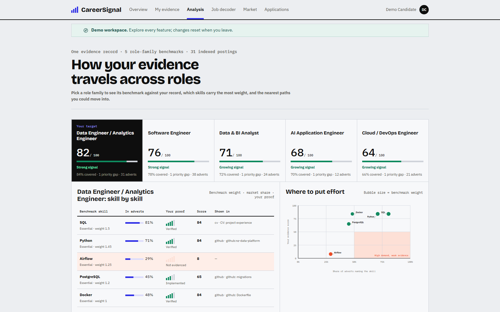
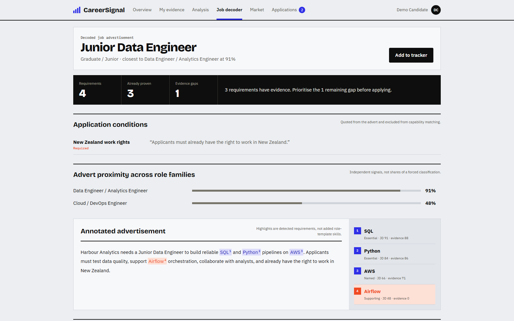
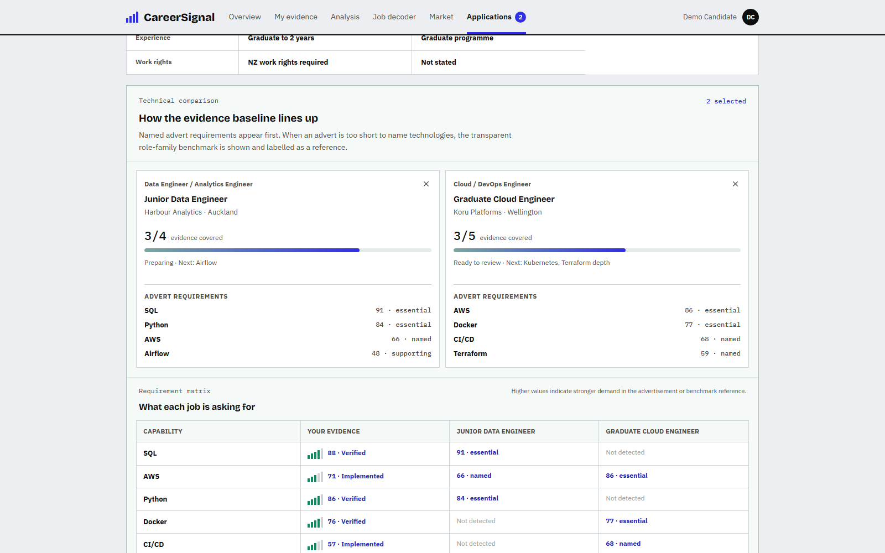
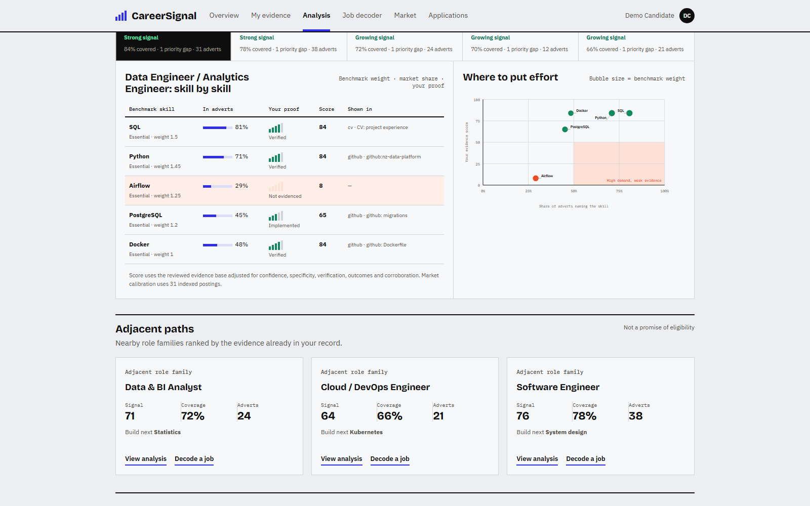

# CareerSignal Tech NZ

[](https://github.com/liyang6620/career-signal-tech-nz/actions/workflows/ci.yml)
[](https://github.com/liyang6620/career-signal-tech-nz/actions/workflows/codeql.yml)
[](https://github.com/liyang6620/career-signal-tech-nz/actions/workflows/live-smoke.yml)
[](https://github.com/liyang6620/career-signal-tech-nz/actions/workflows/android-apk.yml)
[](LICENSE)

CareerSignal turns CV, GitHub and New Zealand job-advertisement evidence into an inspectable capability profile. It separates what a candidate can demonstrate from what a role asks for, then supports role comparison, career planning and application tracking without hiding the reasoning behind a single opaque score.

This repository targets a stable interview demo and a product-grade portfolio standard. It does not claim the operational guarantees required for unrestricted commercial use.

## Try the demo

- Web: [career-signal-tech-nz.pages.dev](https://career-signal-tech-nz.pages.dev)
- API health: [health](https://careersignal-api-ze3r.onrender.com/health) · [readiness](https://careersignal-api-ze3r.onrender.com/ready)
- Android: download `CareerSignal-debug-apk` from the latest [Android workflow](https://github.com/liyang6620/career-signal-tech-nz/actions/workflows/android-apk.yml)

Select **Explore live demo** on the home page. It opens a safe, pre-populated workspace without registration or email verification. Demo changes remain in the browser session and never write to a real account.

The API uses Render's free tier and may need roughly 10–60 seconds to wake after inactivity. The client shows this state and retries transient gateway responses instead of presenting an indefinite loading screen.

### 90-second interview walkthrough

1. Open **Overview** to show the target role, evidence signal, source coverage and next actions.
2. Open **My evidence** to inspect the reviewed CV, GitHub and portfolio evidence behind the scores.
3. Open **Analysis**, switch role families and show the skill benchmark, leverage view and adjacent paths.
4. Open **Job decoder** and show advert-specific requirements and explainable evidence comparison.
5. Open **Market** to inspect NZ demand and ask the source-linked job records a focused question.
6. Open **Applications**, select two saved roles and compare technical requirements and decision factors.

## Product tour

| Role-family analysis | Job-advertisement decoder |
| --- | --- |
| [](docs/screenshots/capability-profile.png) | [](docs/screenshots/role-decoder.png) |
| **Saved-role comparison** | **Adjacent career paths** |
| [](docs/screenshots/saved-role-comparison.png) | [](docs/screenshots/career-pathways.png) |

## Product capabilities

- Private CV ingestion with file checks, extraction status and user-reviewed evidence
- Conservative public GitHub evidence extraction with provenance
- Portable capability profile across Software, Data, AI and Cloud role families
- New Zealand market explorer backed by governed, source-linked records
- Job-description decoder with hard eligibility requirements kept separate from skill fit
- Cited employer-evidence retrieval and optional grounded summaries
- Saved-role comparison, notes, status history and application tracking
- Account export and deletion controls
- Installable PWA and Capacitor Android wrapper

The authenticated workspace uses six primary destinations: **Overview**, **My evidence**, **Analysis**, **Job decoder**, **Market** and **Applications**. The former Profile and Pathways experiences are combined in Analysis, while source-linked employer evidence retrieval is part of Market.

Scores are deterministic and auditable. Evidence maturity, extraction confidence, source triangulation, role demand and market frequency remain separate signals. They indicate the strength of available evidence, not human ability or a hiring outcome.

## Architecture

```text
React / TypeScript / Vite / Capacitor
                |
        FastAPI application
          |             |
PostgreSQL + pgvector   S3-compatible private storage
          |
governed collectors + hybrid retrieval + background worker
```

Core stack:

- React 19, TypeScript and Vite with responsive CSS and inline SVG data views
- Python 3.12, FastAPI, Pydantic and SQLAlchemy
- PostgreSQL 16, pgvector and Alembic
- Argon2 passwords, short-lived JWTs and rotated refresh sessions
- S3-compatible storage, file-signature checks and ClamAV-compatible scanning
- GitHub Actions for CI, CodeQL, Android builds and deployed smoke checks

See [architecture](docs/architecture.md), [product scope](docs/product-scope.md) and [scoring methodology](docs/skill-benchmark-methodology.md) for design details.

## Run locally

Prerequisites: Node.js 22, Python 3.12 and Docker for the full PostgreSQL/storage stack.

```bash
git clone https://github.com/liyang6620/career-signal-tech-nz.git
cd career-signal-tech-nz
cp .env.example .env
# Fill POSTGRES_PASSWORD (URL-safe alphanumeric), JWT_SECRET, STORAGE_ACCESS_KEY,
# STORAGE_SECRET_KEY and INGESTION_API_KEY with unique random values.
docker compose up --build
```

Compose publishes the API and MinIO development endpoints on `127.0.0.1` only. PostgreSQL and ClamAV remain internal to the Compose network. The committed example deliberately leaves every secret blank; Compose refuses to start until the required values are supplied.

### Container recovery and image upgrades

All long-running services use `restart: unless-stopped`. API startup exposes liveness immediately but keeps `/ready` at HTTP 503 while it retries PostgreSQL up to 30 times and applies Alembic migrations. The worker uses the same bounded database retry and waits for object storage before reporting healthy. This protects Docker Desktop restarts without hiding a permanent dependency failure.

Runtime images are intentionally pinned: pgvector `0.8.1-pg16`, ClamAV `1.4.3`, and the archived Bitnami MinIO distribution `2025.7.23-debian-12-r3`. The legacy MinIO image is fixed because the upstream community registry no longer retains versioned images; treat replacement with a maintained S3-compatible image as a deliberate migration. To upgrade an image:

1. Read the upstream release notes and choose an explicit version.
2. Pull and inspect the image, then update the version or digest in both Compose files.
3. Run backend tests and `docker compose config`.
4. Run `docker compose down` without `-v`, followed by `docker compose up -d --build` and the restart-recovery check below.
5. Commit the image change and verification result. Never use `latest` or delete the named data volumes during an upgrade.

Recovery check (PowerShell):

```powershell
docker compose down                 # never add -v
docker compose up -d --build
docker compose restart
docker compose ps
Invoke-RestMethod http://127.0.0.1:8000/ready
```

Every service should become `healthy`, and readiness should return `{"status":"ready","service":"career-signal-api"}`.

### Frontend and backend development

PostgreSQL remains private to the Compose network, so run the backend through
Compose rather than starting Alembic or Uvicorn directly on the host. The
standard backend uses the same supervised startup path as the full stack:

```bash
docker compose up --build api
```

Compose starts the API dependencies, applies migrations inside the API
container and publishes the API only on `127.0.0.1:${API_HOST_PORT:-8000}`.
The database still has no host port. For API source hot reload, add the
development override:

```bash
docker compose -f docker-compose.yml -f docker-compose.dev.yml up --build api
```

The override bind-mounts only `backend/app/`, runs migrations inside the
container, and starts Uvicorn with `--reload`. Rebuild the image after changing
`pyproject.toml`, migrations or other files outside `backend/app/`. Stop the
development stack with the same file arguments and without `-v`:

```bash
docker compose -f docker-compose.yml -f docker-compose.dev.yml down
```

Run the frontend separately for Vite hot reload:

```bash
cd frontend
npm ci
npm run dev
```

The frontend defaults to `http://localhost:5173`. The API and OpenAPI UI use
`http://127.0.0.1:${API_HOST_PORT:-8000}` and
`http://127.0.0.1:${API_HOST_PORT:-8000}/docs` respectively. On Windows, read
the concrete port from `API_HOST_PORT` in `.env` rather than using the shell
placeholder literally.

## Verification

Run the backend suite inside an isolated Compose project so PostgreSQL stays internal and the development data volume is not used:

```bash
docker compose -p career-signal-compose-test -f docker-compose.yml -f docker-compose.test.yml run --rm backend-test
docker compose -p career-signal-compose-test -f docker-compose.yml -f docker-compose.test.yml down
```

The second command intentionally omits `-v`; inspect and remove only the isolated test volume separately when it is no longer needed.

```bash
cd backend
ruff check app tests
python -m app.evaluation_report --minimum 1.0
pytest --cov=app --cov-report=term-missing --cov-fail-under=80

cd ../frontend
npm run lint
npm run test:unit
npm run build
npm run test:e2e
```

CI also starts `pgvector/pgvector:pg16`, applies every Alembic migration and enables the PostgreSQL hybrid-search integration test. Playwright runs critical journeys in Desktop Chrome and a Pixel 7 viewport, including accessibility checks. Frontend unit coverage has enforced thresholds; backend coverage must remain at or above 80%.

The labelled evaluation command emits machine-readable JD role/scope accuracy, expected-skill recall, eligibility recall, CV skill recall and evidence-level constraint accuracy. Retrieval evaluation reports Recall@K and mean reciprocal rank when a governed corpus has been indexed. Dataset size and interpretation are documented in [evaluation](docs/evaluation.md).

## Security and data boundaries

- `.env` and credentials are excluded from Git.
- Market writes require a separate ingestion credential.
- CV evidence must pass validation and explicit user review before scoring.
- API routes, mutations and cross-origin data are excluded from service-worker caching.
- CodeQL and dependency updates run in GitHub Actions.
- Vulnerability reports follow [SECURITY.md](SECURITY.md); contributions follow [CONTRIBUTING.md](CONTRIBUTING.md).

## Demo limitations

- The free Render API sleeps after inactivity and is not an SLA-backed service.
- Market counts cover only permitted records currently indexed; they are not official NZ labour-market totals.
- The committed labelled sets are regression baselines, not statistical proof of model accuracy.
- Resend's test sender limits real registration email delivery until a custom sending domain is configured.
- Owner-controlled, redacted CVs are the only supported live-demo uploads.
- Backups, restore drills, managed telemetry, multi-region operation and unrestricted public uploads are outside this portfolio release.
- The Android artifact is debug-signed for interviews, not a Play Store release.

Deployment and operations details are in [deployment-demo](docs/deployment-demo.md) and [operations](docs/operations.md).

## Repository map

```text
backend/app/        API, extraction, scoring, retrieval and worker modules
backend/migrations/ Alembic schema history
backend/evaluation/ versioned labelled regression sets
backend/tests/      API, security, scoring, collector and PostgreSQL tests
frontend/src/       React product, API client, domain helpers and demo adapter
frontend/e2e/       desktop/mobile critical journeys and accessibility checks
docs/               architecture, scope, evaluation, deployment and operations
.github/workflows/  CI, CodeQL, Android build and live smoke monitoring
```

## License

[MIT](LICENSE)
